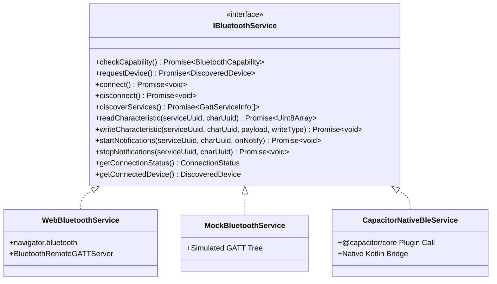

# DIZO Watch Lab: Android Conversion & Capacitor Migration Architecture

This architectural document defines the technical roadmap for packaging **DIZO Watch Lab** into an Android application using **Capacitor** and transitioning from Web Bluetooth to native Android BLE APIs (`android.bluetooth`).

---

## 1. Why Transition Beyond Web Bluetooth on Android?

While Web Bluetooth works cleanly on desktop Chrome/Edge and on Android over `localhost` (via ADB reverse), a native Android application provides essential capabilities for smartwatch maintenance:

| Capability | Web Bluetooth (Browser) | Native Android BLE (Capacitor) |
| :--- | :--- | :--- |
| **User Device Chooser** | Mandatory browser modal prompt on every session | Can store device MAC address and connect directly in background |
| **Background Connectivity** | Paused / killed when browser tab is backgrounded | Operates continuously via Android Foreground Service |
| **Secure Context Requirement** | Requires HTTPS or localhost | Native app bypasses web secure context restrictions |
| **Periodic Time Auto-Sync** | Only while webpage is in active focus | Scheduled via Android `WorkManager` or AlarmManager |
| **GATT MTU Negotiation** | Handled implicitly by browser (often 23-512 bytes) | Explicit `bluetoothGatt.requestMtu(512)` control |
| **Bonding & Pairing Control** | Browser delegates to OS without fine API hooks | Native `device.createBond()` and pin handling |

---

## 2. Abstraction Boundary: The `IBluetoothService` Bridge

DIZO Watch Lab was specifically architected with a decoupled Bluetooth layer:



To create the native Android version, you simply create `CapacitorNativeBleService.ts` implementing `IBluetoothService`. The entire React user interface (Dashboard, GATT Explorer, Time Sync Lab, Command Laboratory, Diagnostic Logs) **requires zero changes**.

---

## 3. Step-by-Step Capacitor Integration

### Step 3.1: Install Capacitor CLI & Core
```bash
npm install @capacitor/core
npm install -D @capacitor/cli @capacitor/android
```

### Step 3.2: Initialize Capacitor Configuration
```bash
npx cap init "DIZO Watch Lab" "com.dizo.watchlab" --web-dir "dist"
```

### Step 3.3: Add Android Platform
```bash
npm run build
npx cap add android
```

---

## 4. Android Manifest Permissions (`android/app/src/main/AndroidManifest.xml`)

Android 12+ (API 31+) mandates specific runtime Bluetooth permissions. Update the manifest:

```xml
<manifest xmlns:android="http://schemas.android.com/apk/res/android"
    package="com.dizo.watchlab">

    <!-- Legacy BLE (Android 11 and lower) -->
    <uses-permission android:name="android.permission.BLUETOOTH" android:maxSdkVersion="30" />
    <uses-permission android:name="android.permission.BLUETOOTH_ADMIN" android:maxSdkVersion="30" />
    <uses-permission android:name="android.permission.ACCESS_FINE_LOCATION" android:maxSdkVersion="30" />

    <!-- Android 12+ Modern BLE Permissions -->
    <!-- 'neverForLocation' informs Android that BLE is strictly used for peripheral communication, not geolocation -->
    <uses-permission 
        android:name="android.permission.BLUETOOTH_SCAN" 
        android:usesPermissionFlags="neverForLocation" />
    <uses-permission android:name="android.permission.BLUETOOTH_CONNECT" />

    <!-- Optional: Background sync service -->
    <uses-permission android:name="android.permission.FOREGROUND_SERVICE" />
    <uses-permission android:name="android.permission.FOREGROUND_SERVICE_CONNECTED_DEVICE" />

    <application
        android:allowBackup="true"
        android:icon="@mipmap/ic_launcher"
        android:label="DIZO Watch Lab"
        android:theme="@style/AppTheme">
        <!-- ... -->
    </application>
</manifest>
```

---

## 5. Native Kotlin BLE Plugin Implementation

In `android/app/src/main/java/com/dizo/watchlab/DizoBlePlugin.kt`:

```kotlin
package com.dizo.watchlab

import android.bluetooth.*
import android.content.Context
import com.getcapacitor.JSObject
import com.getcapacitor.Plugin
import com.getcapacitor.PluginCall
import com.getcapacitor.PluginMethod
import com.getcapacitor.annotation.CapacitorPlugin
import java.util.UUID

@CapacitorPlugin(name = "DizoBle")
class DizoBlePlugin : Plugin() {

    private var bluetoothAdapter: BluetoothAdapter? = null
    private var activeGatt: BluetoothGatt? = null

    override fun load() {
        val bluetoothManager = context.getSystemService(Context.BLUETOOTH_SERVICE) as BluetoothManager
        bluetoothAdapter = bluetoothManager.adapter
    }

    @PluginMethod
    fun connectDevice(call: PluginCall) {
        val address = call.getString("address") ?: run {
            call.reject("Device MAC address is required")
            return
        }

        val device = bluetoothAdapter?.getRemoteDevice(address) ?: run {
            call.reject("Device not found")
            return
        }

        activeGatt = device.connectGatt(context, false, object : BluetoothGattCallback() {
            override fun onConnectionStateChange(gatt: BluetoothGatt, status: Int, newState: Int) {
                if (newState == BluetoothProfile.STATE_CONNECTED) {
                    gatt.discoverServices()
                    val ret = JSObject()
                    ret.put("status", "connected")
                    notifyListeners("onConnectionStatus", ret)
                } else if (newState == BluetoothProfile.STATE_DISCONNECTED) {
                    val ret = JSObject()
                    ret.put("status", "disconnected")
                    notifyListeners("onConnectionStatus", ret)
                }
            }

            override fun onServicesDiscovered(gatt: BluetoothGatt, status: Int) {
                val servicesArray = gatt.services.map { service ->
                    val sObj = JSObject()
                    sObj.put("uuid", service.uuid.toString())
                    sObj
                }
                val ret = JSObject()
                ret.put("services", servicesArray)
                notifyListeners("onServicesDiscovered", ret)
            }
        })

        call.resolve()
    }

    @PluginMethod
    fun writeCharacteristic(call: PluginCall) {
        val serviceUuid = UUID.fromString(call.getString("serviceUuid"))
        val charUuid = UUID.fromString(call.getString("characteristicUuid"))
        val hexPayload = call.getString("payloadHex") ?: ""

        val bytes = hexStringToByteArray(hexPayload)
        val char = activeGatt?.getService(serviceUuid)?.getCharacteristic(charUuid)

        if (char == null) {
            call.reject("Characteristic not found")
            return
        }

        char.value = bytes
        val success = activeGatt?.writeCharacteristic(char) ?: false
        if (success) {
            call.resolve()
        } else {
            call.reject("GATT write failed")
        }
    }

    private fun hexStringToByteArray(s: String): ByteArray {
        val clean = s.replace(" ", "").replace("0x", "")
        val len = clean.length
        val data = ByteArray(len / 2)
        var i = 0
        while (i < len) {
            data[i / 2] = ((Character.digit(clean[i], 16) shl 4) + Character.digit(clean[i + 1], 16)).toByte()
            i += 2
        }
        return data
    }
}
```

---

## 6. Verification and Deployment

1. Sync web bundle to Android Studio project:
   ```bash
   npm run build
   npx cap sync
   ```
2. Open Android project in Android Studio:
   ```bash
   npx cap open android
   ```
3. Run on a connected Android phone or generate release APK.
